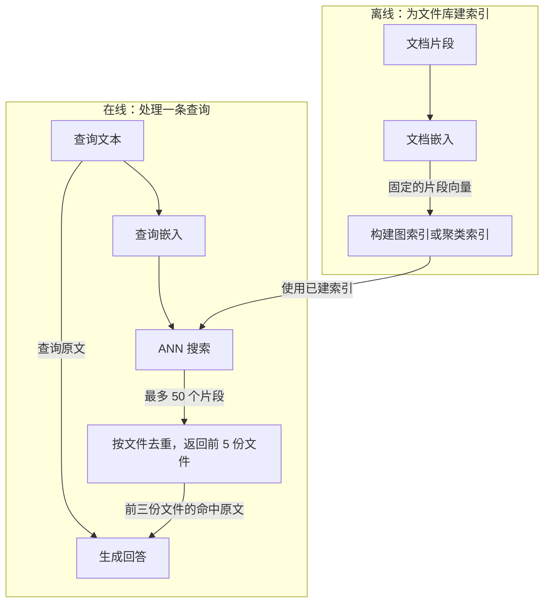

# 智能计算系统编程作业：RAG 文件检索

文件检索的任务是：给定一条查询，从文件库中找出相关文件，按相关程度排序。例如，输入一段案情，系统会返回最值得查阅的判决文件。一份长判决可能只有一段与查询相关，因此本实验先检索片段，再根据命中的片段给文件排名。

你将在同一批查询上比较两种自己实现的索引：一种图索引，一种聚类索引。通过调整构建参数和查询参数，观察近似最近邻（ANN）搜索能找回多少精确近邻、最终能否找到相关文件，以及离线和在线各阶段分别耗时多久。

## 数据集与 RAG 流程

实验使用 FIRE 2019 AILA 的 MTEB 英文整理版，包含 **186 份判决文件**。文件已切成 **8,045 个片段**，50 条查询分为 10 条开发查询和 40 条测试查询。数据集给出了 195 条“查询—相关文件”标注，用来核对返回的文件。实验还提供逐一比较全部片段向量得到的排名，用来核对索引返回的片段。[数据与标注](data/) · [上游快照](https://huggingface.co/datasets/mteb/AILA_casedocs/tree/389dc76716833d7ef45703f41e2867727ad9c922) · [赛题论文](https://ceur-ws.org/Vol-2517/T1-1.pdf) · [CC BY 4.0 许可](https://creativecommons.org/licenses/by/4.0/)

LangGraph 串起下面的流程。文档和查询共用 **all-MiniLM-L6-v2** 嵌入模型；建索引和查索引调用你的算法；文件去重按片段排名完成；最后由 llama.cpp 运行 **Qwen2.5-0.5B-Instruct（Q4_K_M）**，根据问题和检索到的原文生成回答。比较索引时，模型、提示词和文件去重规则均固定。[嵌入模型](https://huggingface.co/sentence-transformers/all-MiniLM-L6-v2/tree/c9745ed1d9f207416be6d2e6f8de32d1f16199bf) · [生成模型](https://huggingface.co/Qwen/Qwen2.5-0.5B-Instruct-GGUF/tree/9217f5db79a29953eb74d5343926648285ec7e67) · [工作流代码](benchmark/runner.py)



## 1. 建分支，跑通基线

准备 Git 和带 Compose 的 Docker。整机至少 8 GB 内存，建议 16 GB；Docker 至少可用 4 个逻辑处理器和 4 GiB 内存。课程容器统一使用 CPU，配额为 4 vCPU。

先将[课程仓库 fork 到自己的 GitHub 账户](https://github.com/w-pq/cpu-file-retrieval-lab/fork)。课程仓库的 `main` 由助教维护。**请在自己的 fork 中用完整学号命名作业分支**，保留前导零。分支名和作业提交后均公开可见。

**在自己的电脑上**运行以下命令，把 `YOUR-GITHUB-ID` 换成自己的 GitHub 用户名，把 `20260001` 换成自己的学号。首次构建会下载依赖和模型，最后一行打开容器终端。

```sh
git clone https://github.com/YOUR-GITHUB-ID/cpu-file-retrieval-lab.git
cd cpu-file-retrieval-lab
git switch -c 20260001
docker compose up -d --build --wait
docker compose exec lab sh
```

**进入容器后**，先运行精确检索基线。后续所有 `bench` 命令都在这个终端执行。

```sh
bench search exact
```

`exact` 会逐一比较全部片段。看到 `queries=10`、`ann_recall10=1.0`、`file_hit5` 约为 `0.4`，就可以开始写索引了。

## 2. 手写两种索引

| 修改的文件 | 可选算法 | 以 HNSW 和 IVF-PQ 为例，需要实现的步骤 |
|---|---|---|
| [indexes/graph.py](indexes/graph.py) | HNSW、NSW 等图索引 | HNSW 建库时分层插入节点、选择邻居并维护连边；查询时从上层找入口，在底层扩展候选。 |
| [indexes/cluster.py](indexes/cluster.py) | IVF-PQ、IVF-Flat 等聚类索引 | IVF-PQ 建库时训练聚类中心、建立倒排表，对残差做乘积量化；查询时选择最近的簇，用距离查找表给候选排序。 |

两个文件使用同一接口。构造函数 `Index(vectors, **params)` 接收 384 维单位向量并建库；`search(query, k, **params)` 返回按相似度从高到低排列的片段行号，最多 `k` 个，行号互不重复。可使用 NumPy 或 PyTorch 的 CPU 数值运算，索引的构建和搜索逻辑须自行编写。用自己电脑上的编辑器修改这两个文件，保存后即可在容器终端运行新代码。

## 3. 运行 Benchmark

**测一次文档嵌入。** 运行 `bench embed`，记录整库文档嵌入耗时。后续各组实验都从仓库提供的同一份向量开始建索引，使参数间的差异可以直接比较。

**在开发集上扫描参数。** 每种索引至少取 **2 组构建参数 × 3 组查询参数**。每组构建参数只建一次索引，再在该索引上跑完各组查询参数。以下示例分别改变 HNSW 的邻居数 `M` 和搜索宽度 `efSearch`，以及 IVF-PQ 的簇数 `nlist` 和探查簇数 `nprobe`。其他算法使用含义相应的参数。

```sh
bench search graph \
  --build M=8,efConstruction=100 --build M=16,efConstruction=100 \
  --search efSearch=64 --search efSearch=128 --search efSearch=256 \
  > results/graph.jsonl

bench search cluster \
  --build nlist=32,m=16,nbits=4 --build nlist=64,m=16,nbits=4 \
  --search nprobe=1 --search nprobe=4 --search nprobe=8 \
  > results/cluster.jsonl
```

**在测试集复测。** 根据开发集结果，为每种索引选定配置。用 `bench search` 加 `--split test`，在全部 40 条测试查询上复测精确基线和两种索引的片段召回率、文件命中率和搜索延迟。再用 `bench online` 对选定配置拆解在线耗时。下面展示固定一张图、只改变查询参数的写法；聚类索引用同样的方式对照。

```sh
bench online graph --split test --build M=16,efConstruction=100 \
  --search efSearch=64 --search efSearch=256 > results/online-graph.jsonl
```

容器中的 `results/` 与电脑上仓库里的同名目录同步。实验结束时输入 `exit` 回到自己的终端，再运行 `docker compose down` 关闭容器。

### 如何读结果

| 要比较的量 | 输出字段 | 测量口径 |
|---|---|---|
| 离线文档嵌入、索引构建 | `doc_embed_s`（秒）、`build_ms`（毫秒） | 前者是整库编码时间；后者从接收现成向量开始，到索引可查询为止，含建图或聚类、量化训练与编码。 |
| 片段召回率（Recall@10） | `ann_recall10` | 逐一比较全部片段，取最相似的 10 个作为参照。如果你的索引返回的前 10 个片段中有 7 个与参照重合，这条查询得 7/10。对所有查询取平均。 |
| 文件命中率（Hit@5） | `file_hit5` | 查看最终排在前 5 的文件，只要其中一份被数据集标为与该查询相关，这条查询就算命中。例如 10 条查询中有 4 条命中，文件命中率就是 40%。 |
| ANN 查询延迟 | `search_p50_ms`、`search_p95_ms` | `bench search` 输入预计算的查询向量，预热后每题跑 3 次，统计索引调用耗时的中位数和第 95 百分位数。 |
| 在线 RAG 各阶段耗时 | `embed_ms`、`search_ms`、`llm_ms`、`workflow_ms` | `bench online` 对固定的 3 条查询分别计时：实时查询嵌入、ANN 检索、生成以及完整请求，单位均为毫秒。总耗时还包含文件聚合和框架开销。 |

## 4. 实验报告

用一张参数表记录每组配置的建库时间、索引额外空间、片段召回率、文件命中率和查询 P50/P95，用一张曲线图展示搜索延迟与片段召回率的关系。基于实测数据回答三个问题：

1. **构建参数的影响。** 固定查询参数，改变邻居数或簇数，建库成本、片段召回率、文件命中率和查询延迟如何变化？
2. **查询参数的影响。** 固定已建索引，扩大搜索范围，多花了多少时间？找回更多精确近邻时，最终文件命中率是否也提高？在片段召回率接近的配置上比较两类索引。
3. **离线与在线的时间分布。** 离线分别报告文档嵌入和索引构建耗时；在线用同一条查询对照不同配置，列出查询嵌入、检索、生成及总耗时，说明各阶段占比和变化主要来自哪里。比较生成耗时时，同时列出输出 token 数。

报告中写明复现命令、CPU、内存、线程设置，以及实验所用代码的提交号。

课程不设速度排行榜，评分综合考虑**实验的可复现性**和**报告质量**。前者看他人能否用提交的代码、参数和命令复现实验。后者看图表能否让读者看清差异、结论是否有具体数据支撑，以及分析能否解释参数对检索效果和耗时的影响。

## 5. 作业提交

助教后续会发布收作业的在线文档。**每人填一行，提交两个链接：自己的 GitHub 学号分支链接和该分支中实验报告的文件链接。** 学号分支中应包含以下三项材料：

- **索引代码**：`indexes/graph.py` 和 `indexes/cluster.py`，包含自己实现的图索引和聚类索引。
- **原始实验结果**：将用于报告分析的 JSONL 或 CSV 文件放在 `results/` 中。
- **实验报告**：将按第 4 节要求完成的报告文件放在仓库根目录，与代码和结果一起推送到 GitHub 的学号分支。

在自己电脑上的仓库根目录运行以下命令，把三项材料推到学号分支：

```sh
git add -A
git status --short
git commit -m "提交索引实验与报告"
git push -u origin HEAD
```

在 GitHub 上打开自己的 fork，切换到学号分支，把地址栏里的链接填入第一列。接着点开该分支根目录下的实验报告，把报告页面的链接填入第二列。填写示例：

| 学号分支链接 | 实验报告链接 |
| --- | --- |
| `https://github.com/xiaoming/cpu-file-retrieval-lab/tree/20260001` | `https://github.com/xiaoming/cpu-file-retrieval-lab/blob/20260001/report.pdf` |

收齐前如需修改，继续推到同一分支即可。如果更改了报告文件名，请同步更新在线文档中的报告链接。
