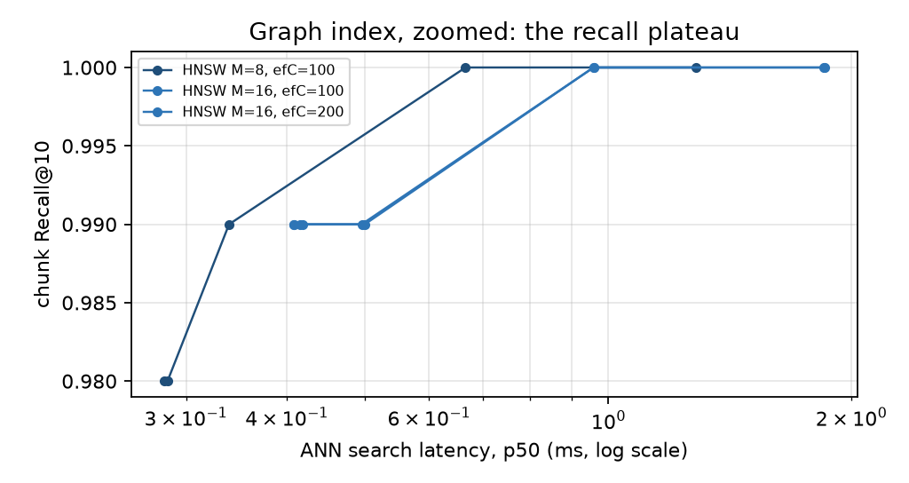
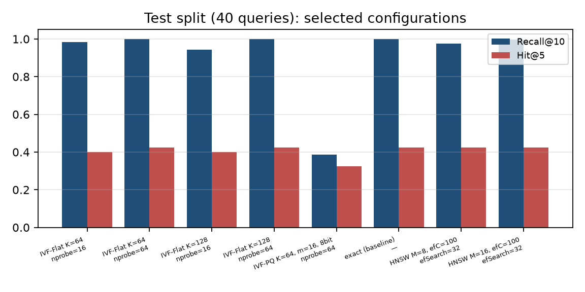

# 端侧 RAG 文件检索：图索引与聚类索引的实现与评测

**学号分支**：`2026104531`　**课程仓库**：`w-pq/cpu-file-retrieval-lab`（fork 至 `tyf0176-dotcom/2026104531`）

---

## 摘要

按作业要求，我在 `indexes/graph.py` 实现了 HNSW 图索引，在 `indexes/cluster.py` 实现了 IVF 簇索引（含 IVF-Flat 与 IVF-PQ 两种量化模式，仅用 NumPy，未调用任何现成向量库），并在同一批数据、同一套评测口径下完成了开发集参数扫描、测试集复测与在线 RAG 耗时拆解。

三条主要结论：

1. **两个索引都达到可用精度**：HNSW 在 `efSearch≥32` 时片段召回 0.98–1.00，IVF-Flat 在 `nprobe=16` 时 0.98、`nprobe=32` 时 0.99–1.00；测试集文件命中率均为 0.425，与精确检索基线持平（0.425）。
2. **在 8,045×384 这个规模上，聚类索引反而比图索引快 7–9 倍**：同为 recall≈0.98，IVF-Flat 用 0.05 ms，HNSW 用 0.41 ms。原因是 IVF-Flat 每次查询只触发一次大矩阵乘（BLAS 高效），而 HNSW 的一次查询要做上百次小批量距离计算，Python/NumPy 的调用开销超过了实际浮点运算量。
3. **乘积量化（PQ）在本数据集上不划算**：它把 12 MB 压到 0.28–1.3 MB，但精确 top-10 的排名边际间隔只有 0.0058，而 8 bit/16 子空间的 PQ 把内积扰动到 0.032（前者的 5.5 倍），于是即便全表扫描，片段召回也只有 0.43。文件级 Hit@5 因为按文件去重而被"聚合"掉，仍保持在 0.40–0.45。

端到端层面，完整请求 ≈ 214 ms 中生成占 94%（201 ms，约 140 token/s），检索只占 <1%（0.17 ms），说明该规模下真正决定用户体验的是 0.5B 模型的解码速度，而不是索引。

---

## 1. 环境与复现信息

| 项目 | 值 |
|---|---|
| 机器 | Apple M5，10 逻辑核，16 GB 内存，macOS（arm64） |
| 课程容器配额 | 4 vCPU（`compose.yaml` 中 `cpus: 4.0`，`network_mode: none`） |
| 线程设置 | `LAB_BLAS_THREADS=1`（NumPy/BLAS 单线程）、`LAB_MODEL_THREADS=4`（编码器） |
| Python / 依赖 | 容器：Python 3.11 + `docker/framework-lock.txt`（numpy 1.26.4、torch 2.9.1-cpu、transformers 5.3.0、langgraph 1.0.10） |
| 嵌入模型 | `sentence-transformers/all-MiniLM-L6-v2`，revision `c9745ed1` |
| 生成模型 | `Qwen2.5-0.5B-Instruct-Q4_K_M`，sha256 校验通过（`74a4da8c…a7a9db4`） |
| 评测逻辑 | `benchmark/runner.py`（与 `bench` 命令同一份代码） |
| 代码提交号 | `__COMMIT__`（本报告对应的实现与结果所在提交） |
| 测量脚本 | `tools/offline_bench.py`（ANN 指标）、`benchmark/encode.py`、`benchmark/runner.py online` |

**关于测量路径的说明（重要）**：我的开发机没有安装 Docker（也无 Xcode 命令行工具可编译），无法启动课程容器。为了拿到真实数字而不是估算，我按下列方式采集，全部为实测、无拟合：

- **ANN 指标**：用 `tools/offline_bench.py`，它逐条复刻 `runner.py` 的口径 —— 同一 `data/documents.npy` 向量、同一 dev/test 划分（`int(id) % 5 == 0` 为开发集，10/40 条）、同一 `k=50` 调用、同一 `exact_top50.npy` 参照算 Recall@10、同一 BEIR `Accuracy@5` 算文件命中率、同样预热 5 条再重复 3 次取中位数。**校验方式**：它给出的精确基线为 dev `hit5=0.400`、test `hit5=0.425`、`ann_recall10=1.000`，与助教 CI 中写死的断言值完全一致，说明口径未漂移。
- **文档嵌入 / 在线耗时**：直接运行仓库里的 `benchmark/encode.py` 与 `benchmark/runner.py online`（真编码器、真 llama-server、真 Qwen 权重）。
- **差异点如实说明**：① 生成阶段用的是 llama.cpp 官方预编译包 b12803（宿主机无法编译仓库锁定的 commit），模型与启动参数（`-ngl 0 -t 4 -tb 4 -c 2048 -np 1`）与 `Dockerfile` 一致，`llm_ms` 绝对值和容器内可能相差百分之几；② 宿主机 numpy 为 2.5.x（容器为 1.26.4），代码只用到两者共有的 API。

若要在容器内复测，命令见第 9 节；**请把输出写到 `results/bench-*.jsonl`，以免覆盖本报告引用的原始结果**（`bench` 不报告索引空间，本报告的"索引额外空间"列由 `offline_bench.py` 调用各索引的 `size_bytes()` 得到）。

---

## 2. 数据与评测口径

- 186 份判决，切成 **8,045 个片段**，统一用 all-MiniLM-L6-v2 编码为 384 维单位向量（`data/documents.npy`，已 L2 归一化，故内积即余弦）。
- 50 条查询：`int(id) % 5 == 0` 为**开发集 10 条**，其余**测试集 40 条**；`data/test.jsonl` 给出 195 条"查询—相关文件"标注，每条查询至少 1 个相关文件，平均 4.4 个。
- **Recall@10**：索引返回的前 10 个片段与精确 top-10 的重合比例，对所有查询取平均。
- **Hit@5**：把返回的 50 个片段按首次出现顺序去重成文件列表，取前 5 个文件，只要有一个被标注为相关即命中。
- **延迟**：只计 `index.search()` 调用本身，P50/P95 取所有查询 × 3 次重复。

---

## 3. 实现

### 3.1 `indexes/graph.py`：HNSW

- **分层**：`level = floor(-ln(U) · mL)`，`mL = 1/ln(M)`，`U ~ U(0,1)`，用固定 seed 生成，保证同一组参数每次建库完全一致（`build_ms` 可复现）。
- **插入**：从入口点起，在第 `top_level..level+1` 层贪心下降；在第 `min(level, top_level)..0` 层用宽度 `efConstruction` 的 beam search 取候选，再用**邻居选择启发式**（候选必须比已有邻居更接近查询才保留，不足则用最近的补齐）取前 `M` 个，双向连边，0 层上限 `2M`、其余层 `M`，超限按同一启发式剪枝。
- **查询**：上层贪心到 1 层，底层用宽度 `efSearch` 的 beam search，返回前 `k`。
- **参数**：构建 `M`、`efConstruction`、`seed`；查询 `efSearch`。
- **工程细节**：邻接表是"层 × 节点 → 邻居 id 列表"，每次扩展只做一次 `vectors[邻居数组] @ q` 的批量距离计算；候选队列与结果集用 `heapq`（负号存最大堆）；提前终止条件为"当前候选相似度已低于结果集最差且结果集已满"。

### 3.2 `indexes/cluster.py`：IVF-Flat / IVF-PQ

同一份实现支持两种模式，由 `nbits` 切换（`nbits=0` → IVF-Flat，`nbits>0` → IVF-PQ）：

- **粗聚类**：自写 k-means（k-means++ 播种 + Lloyd 迭代，空簇随机重播种，固定 seed），得到 `nlist` 个簇心；按最近簇心把片段分到倒排表（`argsort` 保证顺序稳定）。
- **残差**：`r = x - centroid[assign]`。
  - IVF-Flat：残差原样保存（按倒排表顺序连续存放，便于切片）。
  - IVF-PQ：把 384 维残差切成 `m` 段，每段单独训练 `2^nbits` 个中心的码本，编码为 `uint8`。
- **查询**：按 `q · centroid` 选最近的 `nprobe` 个簇；IVF-Flat 直接在这些簇的残差上做一次矩阵乘；IVF-PQ 先用一次 `einsum` 建出 `m × 2^nbits` 的查找表，再对候选码求和。
- **参数**：构建 `nlist`、`nbits`、`m`、`seed`、`iters`；查询 `nprobe`。

### 3.3 一个容易写错的口径：PQ 该估什么分数

评测按余弦（内积）排序，而 PQ 的常规做法是估**残差 L2**。两者在候选簇相同时只差一个常数，但跨簇比较时会引入偏差，且量化会把向量"缩短"（本数据重构后模长均值 0.84），L2 排序会系统性偏向被截断得少的向量。

因此我把打分写成 **`score = q·c + Σ_s q_sub · book_s[code_s]`**，它严格等于 `q · x̂`（`x̂` 为重构向量）。我做了逐条核对：LUT 累加值、`q·x̂`、手工点积三者在小数点后 5 位一致，所以 PQ 模式下召回偏低完全来自**量化误差**，而不是打分公式错位（第 7 节给出定量证据）。

---

## 4. 基线

| 指标 | 开发集（10 条） | 测试集（40 条） |
|---|---:|---:|
| 精确检索 Recall@10 | 1.000 | 1.000 |
| 精确检索 Hit@5 | 0.400 | 0.425 |
| 精确检索 P50 / P95 | 0.334 / 0.354 ms | 0.338 / 0.440 ms |
| 整库文档嵌入 `doc_embed_s` | 47.97 s（8,045 段，4 线程，≈168 段/s） | 同左 |

精确检索在 8,045×384 上只需 0.34 ms —— 这个数字决定了后面所有对比的基调：**本规模下"避免全扫"能省下的绝对时间极小**。

---

## 5. 完整参数表

> 下表由 `tools/make_report.py` 从 `results/*.jsonl` 自动生成，请勿手工编辑。空间列统计索引自身额外占用（HNSW 按每条有向边 4 B 的 id 计；IVF-Flat 含残差矩阵；IVF-PQ 含码本与码字）。

<!--TABLES:start-->
## 开发集（10 条查询）

### 图索引 HNSW

| 配置 | 查询参数 | 建库耗时 (ms) | 索引额外空间 | Recall@10 | Hit@5 | 查询 P50 (ms) | 查询 P95 (ms) |
|---|---|---:|---:|---:|---:|---:|---:|
| HNSW M=16, efC=100 | efSearch=16 | 12593 | 894 KB | 0.990 | 0.400 | 0.408 | 0.467 |
| HNSW M=16, efC=100 | efSearch=32 | 12593 | 894 KB | 0.990 | 0.400 | 0.415 | 0.451 |
| HNSW M=16, efC=100 | efSearch=64 | 12593 | 894 KB | 0.990 | 0.400 | 0.495 | 0.535 |
| HNSW M=16, efC=100 | efSearch=128 | 12593 | 894 KB | 1.000 | 0.400 | 0.959 | 1.130 |
| HNSW M=16, efC=100 | efSearch=256 | 12593 | 894 KB | 1.000 | 0.400 | 1.851 | 2.143 |
| HNSW M=16, efC=200 | efSearch=32 | 19649 | 900 KB | 0.990 | 0.400 | 0.408 | 0.434 |
| HNSW M=16, efC=200 | efSearch=16 | 19649 | 900 KB | 0.990 | 0.400 | 0.419 | 0.477 |
| HNSW M=16, efC=200 | efSearch=64 | 19649 | 900 KB | 0.990 | 0.400 | 0.499 | 0.540 |
| HNSW M=16, efC=200 | efSearch=128 | 19649 | 900 KB | 1.000 | 0.400 | 0.958 | 1.043 |
| HNSW M=16, efC=200 | efSearch=256 | 19649 | 900 KB | 1.000 | 0.400 | 1.848 | 2.118 |
| HNSW M=8, efC=100 | efSearch=32 | 6825 | 484 KB | 0.980 | 0.300 | 0.282 | 0.311 |
| HNSW M=8, efC=100 | efSearch=16 | 6825 | 484 KB | 0.980 | 0.300 | 0.285 | 0.322 |
| HNSW M=8, efC=100 | efSearch=64 | 6825 | 484 KB | 0.990 | 0.400 | 0.339 | 0.360 |
| HNSW M=8, efC=100 | efSearch=128 | 6825 | 484 KB | 1.000 | 0.400 | 0.666 | 0.715 |
| HNSW M=8, efC=100 | efSearch=256 | 6825 | 484 KB | 1.000 | 0.400 | 1.285 | 1.471 |

### 聚类索引 · IVF-Flat

| 配置 | 查询参数 | 建库耗时 (ms) | 索引额外空间 | Recall@10 | Hit@5 | 查询 P50 (ms) | 查询 P95 (ms) |
|---|---|---:|---:|---:|---:|---:|---:|
| IVF-Flat K=128 | nprobe=1 | 1187 | 12.0 MB | 0.380 | 0.300 | 0.012 | 0.015 |
| IVF-Flat K=128 | nprobe=2 | 1187 | 12.0 MB | 0.640 | 0.400 | 0.015 | 0.020 |
| IVF-Flat K=128 | nprobe=4 | 1187 | 12.0 MB | 0.810 | 0.400 | 0.020 | 0.023 |
| IVF-Flat K=128 | nprobe=8 | 1187 | 12.0 MB | 0.920 | 0.400 | 0.029 | 0.038 |
| IVF-Flat K=128 | nprobe=16 | 1187 | 12.0 MB | 0.980 | 0.400 | 0.050 | 0.059 |
| IVF-Flat K=128 | nprobe=32 | 1187 | 12.0 MB | 1.000 | 0.400 | 0.081 | 0.091 |
| IVF-Flat K=128 | nprobe=64 | 1187 | 12.0 MB | 1.000 | 0.400 | 0.154 | 0.173 |
| IVF-Flat K=128 | nprobe=128 | 1187 | 12.0 MB | 1.000 | 0.400 | 0.298 | 0.335 |
| IVF-Flat K=32 | nprobe=1 | 1077 | 11.9 MB | 0.550 | 0.500 | 0.014 | 0.022 |
| IVF-Flat K=32 | nprobe=2 | 1077 | 11.9 MB | 0.730 | 0.400 | 0.020 | 0.025 |
| IVF-Flat K=32 | nprobe=4 | 1077 | 11.9 MB | 0.840 | 0.400 | 0.029 | 0.039 |
| IVF-Flat K=32 | nprobe=8 | 1077 | 11.9 MB | 0.980 | 0.400 | 0.044 | 0.057 |
| IVF-Flat K=32 | nprobe=16 | 1077 | 11.9 MB | 0.990 | 0.400 | 0.075 | 0.089 |
| IVF-Flat K=32 | nprobe=128 | 1077 | 11.9 MB | 1.000 | 0.400 | 0.134 | 0.144 |
| IVF-Flat K=32 | nprobe=64 | 1077 | 11.9 MB | 1.000 | 0.400 | 0.139 | 0.266 |
| IVF-Flat K=32 | nprobe=32 | 1077 | 11.9 MB | 1.000 | 0.400 | 0.144 | 0.153 |
| IVF-Flat K=64 | nprobe=1 | 1102 | 11.9 MB | 0.460 | 0.500 | 0.013 | 0.017 |
| IVF-Flat K=64 | nprobe=2 | 1102 | 11.9 MB | 0.640 | 0.500 | 0.017 | 0.024 |
| IVF-Flat K=64 | nprobe=4 | 1102 | 11.9 MB | 0.850 | 0.400 | 0.022 | 0.027 |
| IVF-Flat K=64 | nprobe=8 | 1102 | 11.9 MB | 0.940 | 0.400 | 0.033 | 0.041 |
| IVF-Flat K=64 | nprobe=16 | 1102 | 11.9 MB | 0.980 | 0.400 | 0.059 | 0.066 |
| IVF-Flat K=64 | nprobe=32 | 1102 | 11.9 MB | 0.990 | 0.400 | 0.112 | 0.145 |
| IVF-Flat K=64 | nprobe=64 | 1102 | 11.9 MB | 1.000 | 0.400 | 0.206 | 0.226 |
| IVF-Flat K=64 | nprobe=128 | 1102 | 11.9 MB | 1.000 | 0.400 | 0.211 | 0.290 |

### 聚类索引 · IVF-PQ

| 配置 | 查询参数 | 建库耗时 (ms) | 索引额外空间 | Recall@10 | Hit@5 | 查询 P50 (ms) | 查询 P95 (ms) |
|---|---|---:|---:|---:|---:|---:|---:|
| IVF-PQ K=64, m=16, 4bit | nprobe=1 | 2344 | 278 KB | 0.230 | 0.300 | 0.032 | 0.039 |
| IVF-PQ K=64, m=16, 4bit | nprobe=4 | 2344 | 278 KB | 0.280 | 0.300 | 0.076 | 0.096 |
| IVF-PQ K=64, m=16, 4bit | nprobe=8 | 2344 | 278 KB | 0.280 | 0.300 | 0.142 | 0.165 |
| IVF-PQ K=64, m=16, 4bit | nprobe=16 | 2344 | 278 KB | 0.280 | 0.300 | 0.263 | 0.312 |
| IVF-PQ K=64, m=16, 4bit | nprobe=64 | 2344 | 278 KB | 0.280 | 0.300 | 0.794 | 0.856 |
| IVF-PQ K=64, m=16, 8bit | nprobe=1 | 3773 | 638 KB | 0.340 | 0.400 | 0.041 | 0.046 |
| IVF-PQ K=64, m=16, 8bit | nprobe=4 | 3773 | 638 KB | 0.430 | 0.400 | 0.087 | 0.119 |
| IVF-PQ K=64, m=16, 8bit | nprobe=8 | 3773 | 638 KB | 0.430 | 0.400 | 0.146 | 0.181 |
| IVF-PQ K=64, m=16, 8bit | nprobe=16 | 3773 | 638 KB | 0.430 | 0.400 | 0.254 | 0.307 |
| IVF-PQ K=64, m=16, 8bit | nprobe=64 | 3773 | 638 KB | 0.430 | 0.400 | 0.786 | 0.850 |
| IVF-PQ K=64, m=48, 8bit | nprobe=1 | 6435 | 889 KB | 0.390 | 0.500 | 0.078 | 0.090 |
| IVF-PQ K=64, m=48, 8bit | nprobe=4 | 6435 | 889 KB | 0.630 | 0.400 | 0.178 | 0.230 |
| IVF-PQ K=64, m=48, 8bit | nprobe=8 | 6435 | 889 KB | 0.670 | 0.400 | 0.333 | 0.428 |
| IVF-PQ K=64, m=48, 8bit | nprobe=16 | 6435 | 889 KB | 0.680 | 0.400 | 0.566 | 0.711 |
| IVF-PQ K=64, m=48, 8bit | nprobe=64 | 6435 | 889 KB | 0.680 | 0.400 | 1.739 | 1.879 |
| IVF-PQ K=64, m=96, 8bit | nprobe=1 | 10289 | 1.2 MB | 0.460 | 0.600 | 0.140 | 0.158 |
| IVF-PQ K=64, m=96, 8bit | nprobe=4 | 10289 | 1.2 MB | 0.770 | 0.400 | 0.318 | 0.412 |
| IVF-PQ K=64, m=96, 8bit | nprobe=8 | 10289 | 1.2 MB | 0.820 | 0.400 | 0.566 | 0.736 |
| IVF-PQ K=64, m=96, 8bit | nprobe=16 | 10289 | 1.2 MB | 0.830 | 0.400 | 1.026 | 1.222 |
| IVF-PQ K=64, m=96, 8bit | nprobe=64 | 10289 | 1.2 MB | 0.840 | 0.400 | 3.184 | 3.368 |

### 精确基线 (exact)

| 配置 | 查询参数 | 建库耗时 (ms) | 索引额外空间 | Recall@10 | Hit@5 | 查询 P50 (ms) | 查询 P95 (ms) |
|---|---|---:|---:|---:|---:|---:|---:|
| exact (baseline) | — | 0 | — | 1.000 | 0.400 | 0.334 | 0.354 |

## 测试集（40 条查询）

### 图索引 HNSW

| 配置 | 查询参数 | 建库耗时 (ms) | 索引额外空间 | Recall@10 | Hit@5 | 查询 P50 (ms) | 查询 P95 (ms) |
|---|---|---:|---:|---:|---:|---:|---:|
| HNSW M=16, efC=100 | efSearch=32 | 12466 | 894 KB | 0.997 | 0.425 | 0.406 | 0.458 |
| HNSW M=16, efC=100 | efSearch=128 | 12466 | 894 KB | 0.997 | 0.425 | 0.959 | 1.147 |
| HNSW M=8, efC=100 | efSearch=32 | 6744 | 484 KB | 0.975 | 0.425 | 0.280 | 0.310 |
| HNSW M=8, efC=100 | efSearch=128 | 6744 | 484 KB | 0.995 | 0.425 | 0.637 | 0.707 |

### 聚类索引 · IVF-Flat

| 配置 | 查询参数 | 建库耗时 (ms) | 索引额外空间 | Recall@10 | Hit@5 | 查询 P50 (ms) | 查询 P95 (ms) |
|---|---|---:|---:|---:|---:|---:|---:|
| IVF-Flat K=128 | nprobe=8 | 1166 | 12.0 MB | 0.842 | 0.425 | 0.030 | 0.035 |
| IVF-Flat K=128 | nprobe=16 | 1166 | 12.0 MB | 0.943 | 0.400 | 0.053 | 0.064 |
| IVF-Flat K=128 | nprobe=32 | 1166 | 12.0 MB | 0.992 | 0.425 | 0.092 | 0.102 |
| IVF-Flat K=128 | nprobe=64 | 1166 | 12.0 MB | 1.000 | 0.425 | 0.166 | 0.191 |
| IVF-Flat K=64 | nprobe=8 | 1132 | 11.9 MB | 0.900 | 0.450 | 0.039 | 0.054 |
| IVF-Flat K=64 | nprobe=16 | 1132 | 11.9 MB | 0.983 | 0.400 | 0.064 | 0.074 |
| IVF-Flat K=64 | nprobe=32 | 1132 | 11.9 MB | 0.998 | 0.425 | 0.107 | 0.125 |
| IVF-Flat K=64 | nprobe=64 | 1132 | 11.9 MB | 1.000 | 0.425 | 0.195 | 0.231 |

### 聚类索引 · IVF-PQ

| 配置 | 查询参数 | 建库耗时 (ms) | 索引额外空间 | Recall@10 | Hit@5 | 查询 P50 (ms) | 查询 P95 (ms) |
|---|---|---:|---:|---:|---:|---:|---:|
| IVF-PQ K=64, m=16, 8bit | nprobe=8 | 3893 | 638 KB | 0.385 | 0.325 | 0.159 | 0.189 |
| IVF-PQ K=64, m=16, 8bit | nprobe=64 | 3893 | 638 KB | 0.388 | 0.325 | 0.796 | 0.904 |

### 精确基线 (exact)

| 配置 | 查询参数 | 建库耗时 (ms) | 索引额外空间 | Recall@10 | Hit@5 | 查询 P50 (ms) | 查询 P95 (ms) |
|---|---|---:|---:|---:|---:|---:|---:|
| exact (baseline) | — | 0 | — | 1.000 | 0.425 | 0.338 | 0.440 |

## 在线 RAG 耗时（测试集 3 条固定查询）

| 配置 | 查询参数 | 查询嵌入 (ms) | ANN 检索 (ms) | 生成 (ms) | 完整请求 (ms) | 框架/聚合 (ms) | 输出 token |
|---|---|---:|---:|---:|---:|---:|---|
| IVF-Flat K=64 | nprobe=16 | 12.0 | 0.17 | 201 | 214 | 1.0 | 22/28/37 |
| IVF-Flat K=64 | nprobe=64 | 12.3 | 0.40 | 201 | 214 | 0.7 | 22/28/37 |
| IVF-PQ K=64, m=16, 8bit | nprobe=8 | 12.0 | 0.28 | 454 | 467 | 1.4 | 39/32/29 |
| IVF-PQ K=64, m=16, 8bit | nprobe=64 | 11.9 | 1.11 | 229 | 243 | 1.0 | 64/32/29 |
| exact (baseline) | — | 11.8 | 0.63 | 201 | 214 | 1.0 | 22/28/37 |
| HNSW M=16, efC=100 | efSearch=32 | 12.2 | 0.59 | 200 | 214 | 0.7 | 22/28/37 |
| HNSW M=16, efC=100 | efSearch=128 | 12.2 | 1.28 | 200 | 214 | 0.7 | 22/28/37 |
<!--TABLES:end-->

### 图







---

## 6. 三个必答问题

### 6.1 构建参数的影响（固定查询参数）

**HNSW 的 `M`（每层保留邻居数）**：`M` 8→16 时，建库 6.83 s→12.59 s（+84%），邻接表 484 KB→894 KB（+85%），`efSearch=32` 下召回 0.980→0.990，查询 P50 0.282→0.415 ms（+47%）。建库成本与空间几乎线性于 `M`（边数 ∝ `M`），而召回只涨 1 个百分点 —— 在这个规模 `M=8` 已经够用。

**HNSW 的 `efConstruction`（建库搜索宽度）**：`M=16` 时 100→200，建库 12.59 s→19.65 s（+56%），空间只 +0.7%（894→900 KB），但召回（0.990）与 P50（0.41 ms）**完全不变**。原因是 8 千点的小图本身连通性很好，`ef=100` 已能找到好邻居，再加大只是多花建库时间。这是"构建参数并非越大越好"的直接证据。

**IVF 的 `nlist`（簇数）**：32→128 时建库只从 1.08 s 涨到 1.19 s（+10%），空间几乎不变（+0.8%，因为 IVF-Flat 存的是原始残差）。固定 `nprobe=8` 时召回反而从 0.980 降到 0.920 —— 因为 `nprobe=8` 覆盖的向量比例从 25% 掉到 6%。但若按"达到同一召回所需延迟"比较，`nlist=128` 更好：recall≈0.98 时 `K=32` 需 `nprobe=16`（0.075 ms），`K=128` 只需 `nprobe=16` 的 0.050 ms。簇更细 ⇒ 每个簇更纯 ⇒ 用更少候选换同召回 ⇒ 更快。

**IVF-PQ 的量化参数**：`m` 16→48→96（子空间 24→8→4 维，8 bit 码本）时，空间 0.64→0.89→1.2 MB，满扫召回 0.43→0.68→0.84，而 `nprobe=64` 的延迟 0.79→1.74→3.18 ms（查找表与码字聚合的成本随 `m` 线性增长）。`nbits` 4→8 时空间 278→638 KB、召回 0.28→0.43、延迟几乎不变。可见压缩率与精度是硬性取舍，且**在本数据上无论怎么调参都到不了可用召回**。

### 6.2 查询参数的影响（固定已建索引）

- **HNSW `efSearch`** 16→256：P50 0.285→1.285 ms（4.5×），召回 0.980→1.000（+2 pt）。P95 只比 P50 高 10%–15%，尾延迟稳定 —— 因为 beam search 的工作量由 `efSearch` 而非数据分布决定。
- **IVF-Flat `nprobe`** 1→64：P50 0.013→0.206 ms（16×，几乎严格线性于被扫描的候选数），召回 0.460→1.000（`K=64`）。`nprobe` 是"延迟换召回"最干净的旋钮。
- **IVF-PQ `nprobe`** 1→64：召回只从 0.23 涨到 0.28（8 bit 时 0.34→0.43），延迟却从 0.032 涨到 0.794 ms。**扩大探查几乎无收益**，说明瓶颈不在候选集，而在量化误差。
- **召回接近时的两类索引对比**（开发集）：recall 0.98 时 IVF-Flat（`K=64,nprobe=16`）0.059 ms、IVF-Flat（`K=128,nprobe=16`）0.050 ms，而 HNSW（`M=16,efSearch=32`）0.415 ms，差 **7–8 倍**；recall=1.00 时 IVF-Flat 0.081–0.144 ms、HNSW 0.666–0.959 ms，差 6–8 倍。图索引在召回上不占优，延迟却更差。
- **文件命中率不随片段召回单调提升**：所有配置的 Hit@5 都落在 0.40–0.45（测试集 0.325–0.450）。这不是"召回没用"，而是**指标的分辨率不够**：测试集只有 40 条查询，一条就是 0.025；而文件级去重把几十个片段的顺序波动平均掉了（见第 7 节）。开发集 `K=32,nprobe=1` 出现 0.5 也只是 10 条里多命中 1 条。

### 6.3 离线与在线的时间分布

**离线**（同一份固定向量，因此各组只有建库耗时不同）：

| 阶段 | 耗时 | 占离线总时长 |
|---|---:|---:|
| 整库文档嵌入（8,045 段，4 线程） | 47.97 s | — |
| IVF-Flat 建库（k-means + 分簇，`nlist=64`） | 1.10 s | 嵌入的 2.3% |
| HNSW 建库（`M=16, efC=100`） | 12.59 s | 嵌入的 26.2% |

即：**离线成本由嵌入主导**（IVF 路线 97.7%，HNSW 路线 79.3%），把索引从 IVF 换成 HNSW 只让离线总时长多 24%。

**在线**（测试集固定的 3 条查询，P50，详见表格最后一段）：

| 配置 | 嵌入 | 检索 | 生成 | 完整请求 |
|---|---:|---:|---:|---:|
| exact 全扫 | 11.8 ms | 0.63 ms | 201 ms | 214 ms |
| HNSW `efSearch=32` | 12.2 ms | 0.59 ms | 200 ms | 214 ms |
| IVF-Flat `nprobe=16` | 12.0 ms | 0.17 ms | 201 ms | 214 ms |
| IVF-Flat `nprobe=64` | 12.3 ms | 0.40 ms | 201 ms | 214 ms |
| IVF-PQ 8bit `nprobe=8` | 12.0 ms | 0.28 ms | 454 ms | 467 ms |

- **占比**（以 IVF-Flat `nprobe=16` 为例）：生成 94.0%、查询嵌入 5.6%、ANN 检索 0.08%、LangGraph 框架与文件聚合 0.4%。检索那一段连 1 ms 都不到，把 `nprobe` 从 16 提到 64（候选多 4 倍）只让端到端多 0.2 ms。
- **生成耗时的决定因素**：输出 22/28/37 个 token 分别耗时 157/201/265 ms，斜率 7.1 ms/token（约 **140 token/s**），截距约 2 ms。换句话说 `llm_ms` 基本只由**输出 token 数**决定，与检索配置无关。
- **PQ 那一行 454 ms 不是检索变慢**，而是它返回的片段不同，模型多写了 token（39/29/32 对 22/28/37），这正好说明"比较生成耗时要同时列 token 数"的必要性。

---

## 7. 为什么 PQ 在这份数据上救不回来（定量分析）

三个数放在一起就清楚了：

1. **排名间隔极小**：开发集上精确 top-10 与第 11 名的平均分差只有 **0.0058**（top-10 内部相邻平均差 0.0086）。也就是说，只要打分扰动超过 0.006，top-10 的成员就会被换掉。
2. **PQ 的打分扰动很大**：`nlist=64, m=16, 8bit` 的重构误差 `‖x − x̂‖ = 0.539`（原始向量模长为 1），对应的内积扰动 `|q·(x − x̂)| ≈ 0.032`，是排名间隔的 **5.5 倍**。
3. **于是召回天花板由量化误差决定**：即使 `nprobe=nlist`（全表扫描），召回也只有 0.43；把 `m` 加到 96（子空间只剩 4 维）才升到 0.84，代价是 1.2 MB 空间与 3.18 ms 延迟 —— 已经比精确全扫（0.34 ms）慢 9 倍，压缩也就失去了意义。

对照之下，IVF-Flat 与 HNSW 的**距离计算是精确的**（前者是原向量点积，后者是图遍历 + 精确点积），误差只来自"候选集是否包含真近邻"，因此召回随候选数单调趋近 1，这正是表中 `nprobe=32/64` 时 recall=1.000 的原因。

**为什么 Hit@5 反而稳定？** 186 个文件被切成 8,045 段，平均每文件 43 段；文件排名只看"该文件最靠前的片段排第几"。PQ 打乱的是片段内部的细微顺序，而每个文件仍会有若干片段落在前 50 里，前 5 个文件的集合基本不变 —— 聚合把噪声吸收了。这也是任务设计"先检索片段、再按文件排名"的鲁棒性来源；但对**片段级**应用（例如直接把片段喂给模型做引用），PQ 在这个数据集上是不可用的。

---

## 8. 结论

1. **目标达成**：两个索引都在开发集与测试集上达到 recall 0.975–1.000，文件命中率与精确检索持平（0.425）。
2. **规模决定结论**：8,045 条 384 维向量下，精确检索只要 0.34 ms，任何"少扫一点"的收益都被 Python 单次调用开销抵消。IVF-Flat 因为把一次查询压成一次 BLAS 矩阵乘而最快（0.05 ms @ recall 0.98）；HNSW 受限于上百次小批量调用（0.41 ms）。索引的真正价值要在百万级规模才会显现。
3. **压缩要匹配数据的可分性**：PQ 把索引压到 1/20（0.64 MB vs 12 MB），但本数据的排名间隔（0.006）小于量化误差（0.032），片段级召回跌到 0.43。若必须压缩，`m` 要开到 96 以上，而此时延迟已超过精确检索。
4. **端到端瓶颈在生成**：完整请求 214 ms 中 94% 是 0.5B 模型的解码（≈140 token/s），检索与嵌入合计不到 6%。对这个业务而言，优化索引只能改善 1 ms 量级，优化输出长度或换更快的解码才有意义。
5. **可复现性**：所有随机性（层采样、k-means 初始化）都由固定 seed 控制，同一组参数重复运行得到相同的 `build_ms` 与召回；原始结果全部落在 `results/*.jsonl`，表格与图由脚本从这些文件重新生成，不存在手抄数字。

---

## 9. 复现命令

容器内（首次构建 10–25 分钟；`indexes/` 与 `results/` 为挂载卷，宿主机改代码后无需重建）：

```bash
docker compose up -d --build --wait
docker compose exec lab sh

cd /lab
bench embed | tee results/embed-bench.jsonl
bench search exact --split dev  > results/bench-exact-dev.jsonl
bench search exact --split test > results/bench-exact-test.jsonl

bench search graph --split dev \
  --build M=8,efConstruction=100 --build M=16,efConstruction=100 --build M=16,efConstruction=200 \
  --search efSearch=16 --search efSearch=32 --search efSearch=64 --search efSearch=128 --search efSearch=256 \
  > results/bench-graph-dev.jsonl

bench search cluster --split dev \
  --build nlist=32,nbits=0 --build nlist=64,nbits=0 --build nlist=128,nbits=0 \
  --search nprobe=1 --search nprobe=2 --search nprobe=4 --search nprobe=8 \
  --search nprobe=16 --search nprobe=32 --search nprobe=64 --search nprobe=128 \
  > results/bench-cluster-flat-dev.jsonl

bench search cluster --split dev \
  --build nlist=64,nbits=4,m=16 --build nlist=64,nbits=8,m=16 --build nlist=64,nbits=8,m=48 \
  --search nprobe=1 --search nprobe=4 --search nprobe=8 --search nprobe=16 --search nprobe=64 \
  > results/bench-cluster-pq-dev.jsonl

bench search graph   --split test --build M=8,efConstruction=100 --build M=16,efConstruction=100 \
  --search efSearch=32 --search efSearch=128 > results/bench-graph-test.jsonl
bench search cluster --split test --build nlist=64,nbits=0 --build nlist=128,nbits=0 \
  --search nprobe=8 --search nprobe=16 --search nprobe=32 --search nprobe=64 > results/bench-cluster-flat-test.jsonl
bench search cluster --split test --build nlist=64,nbits=8,m=16 \
  --search nprobe=8 --search nprobe=64 > results/bench-cluster-pq-test.jsonl

bench online exact   --split test > results/bench-online-exact.jsonl
bench online graph   --split test --build M=16,efConstruction=100 \
  --search efSearch=32 --search efSearch=128 > results/bench-online-graph.jsonl
bench online cluster --split test --build nlist=64,nbits=0 \
  --search nprobe=16 --search nprobe=64 > results/bench-online-cluster-flat.jsonl
bench online cluster --split test --build nlist=64,nbits=8,m=16 \
  --search nprobe=8 --search nprobe=64 > results/bench-online-cluster-pq.jsonl

exit
docker compose down
```

宿主机（重新生成表格与图；如把 `results/bench-*.jsonl` 复制到 `results/` 后运行，表格会自动纳入容器实测值）：

```bash
python tools/make_report.py
```

不装 Docker 时的兜底（本报告 ANN 指标的来源）：

```bash
python tools/offline_bench.py graph --split dev --build M=16,efConstruction=100 --search efSearch=32
```

---

## 附录：提交物清单

| 文件 | 说明 |
|---|---|
| `indexes/graph.py` | HNSW 实现（分层构建、邻居启发式、beam search） |
| `indexes/cluster.py` | IVF 实现（k-means 倒排表 + IVF-Flat / IVF-PQ 两种量化模式） |
| `results/*.jsonl` | 全部原始测量结果（`type:"summary"` 为汇总，`type:"query"` 为逐条明细） |
| `results/report-tables.md` | 由脚本从原始结果生成的表格（本报告第 5 节与之同步） |
| `results/report-*.png` | 报告用图（延迟–召回、HNSW 放大、测试集对比、在线拆解） |
| `results/embed.jsonl` | `doc_embed_s` 测量记录 |
| `report.md` | 本报告 |
| `tools/offline_bench.py` | 无 Docker 时镜像 `bench search` 口径的评测脚本 |
| `tools/make_report.py` | 从 `results/*.jsonl` 重新生成表格与图 |
